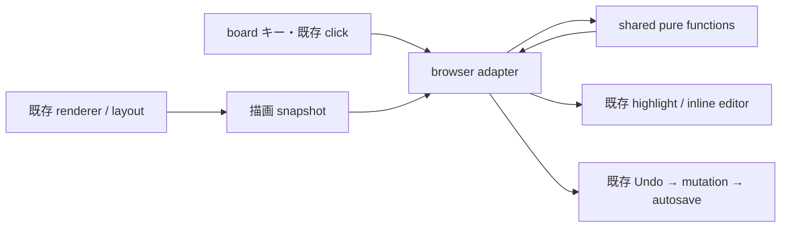

# Design Document

## Overview

全 Surface View の Connection 選択を、描画 snapshot を入力にする pure function と既存 viewer の接続アダプターで実現する。L1 / DC35–DC38 を固定し、L2 / L3 / L4 は requirements.md の提案群として独立してレビューする。OP40 / OP41（承認済み 2026-10-20）を採用し、IS111 / IS112は解決済み。完了対象は実装済みのTree / Axial / Disperse / System / Lane down/right。IS110 / IS114 は DC39 / DC40（2026-10-24 akaghef）で解決済み。IS113のRadialは別作業へ引き継ぐ。

### Goals / Non-Goals

候補集合・順序・選択遷移・編集可否を DOM から分離し、Lane の帯や Disperse の枠でも同じ選択 identity を保つ。既存 renderer、node navigation、履歴を活用する。新しい renderer / server / layout engine / GraphLink 作成 UI / 親子構造編集は作らない。

## Boundary Commitments

### This Spec Owns

選択の一時状態、キーから選択・編集要求への純粋な変換、描画された対象の snapshot 契約、強調と label editor の表示アダプター、既存 mutation 経路への接続、受入確認を所有する。製品用語は Connection（DC39、IS110 解決済み）とする。実装上の union 型名は既存のコード識別子を維持する。

### Out of Boundary / Allowed Dependencies

永続 Topology、Surface View 配置、scope authority、GraphLink 作成、sync protocol、rendererのGraphLink除外・集約規則は変更しない。Disperse のガイドは DC40 に従って選択時のみ描画する。`types.ts`、`parent_child_edge_adapter.ts` の `ParentChildEdgeRef`、`edge_port.ts` / `edge_route.ts`、既存 GraphLink 経路、`lane_navigation.ts`、node 描画、既存 Undo / Redo / autosave を依存先とする。選択のために route のコピーや最近傍 port 再計算を作らない。

### Revalidation Triggers

描画対象の除外・集約・代表 node、layout の座標定義、scope / collapse、選択・履歴 snapshot、キー所有権、render cache / WebGL 更新経路の変更時に対応 test を再実行する。OP40 / OP41の契約を変更する場合は再承認を要する。Radial実装の有無は今回の完了判定に使わない。

## M3E Operating Context

S17 の一枚絵運用と S3 の安全な復元を支える `beta/` の操作仕様。source は指定された `codex/edge-graphlink-selection` worktree、調査基準は `ad1f40b7e1c4a9f00939625b1fb3fcd9c5ac2577`（Lane を含む基準版）。map state が正本、選択は transient。今回の書込範囲はこの仕様フォルダのみ。実装・integration・commit は本ターンでは実行しない。

## Architecture

### Existing Architecture Analysis

現在は `viewState.selectedLinkId` と `selectedGraphLinkId`、node 選択が並存する。GraphLink 選択は node 選択集合を空にするが起点専用状態はない。Alt を除外する矢印 handler と、node を対象とする F2 がある。GraphLink の port / Delete と親子 label は既存 Undo 経路を持つ。親子 label の入力位置は右向きTreeを仮定した幾何であり、Surface View に応じた位置契約ではない。詳細な根拠は research.md「選択・入力」「編集・履歴」。

### Architecture Pattern and Boundary Map



選択 pure function は Surface View を入力に取らない。描画側が「線・帯・枠のどれを描いたか」と元の Connection への対応を供給する。Lane の描画差は `lane_scene.ts` と表示アダプターだけに閉じる。

### Technology Stack

| 層 | 選択 | 理由 |
|---|---|---|
| shared | 既存 TypeScript、readonly の値入力 | DOM / I/O を含まない判定 |
| browser | 既存 SVG / WebGL と textarea | 新しい UI framework や renderer を導入しない |
| 保存 | 既存 AppState / Undo / autosave | 二つ目の履歴・保存経路を作らない |
| 検証 | 既存 Vitest / Playwright / createAppServer | 本番 viewer を隔離データで確認 |

## File Structure Plan

以下は**将来の実装時**の配置案であり、今回作成する source ではない。

| ファイル | 新規 / 既存 | 責務 |
|---|---|---|
| `beta/src/shared/edge_graphlink_selection.ts` | 新規 | 型、候補列挙、読み順、親子選択、L2 移動、状態遷移、強調対象の計画 |
| `beta/src/shared/edge_graphlink_edit.ts` | 新規 | L3 のキー判定・編集要求・Delete 可否・L4 status 整形。副作用なし |
| `beta/src/browser/edge_graphlink_selection_adapter.ts` | 新規 | DOM input guard、snapshot 収集、既存選択との接続、highlight / editor の lifecycle と effect 実行 |
| `beta/src/browser/viewer.ts` | 既存 | adapter の構築、render 完了・キー・click・Undo 後の通知だけ |
| `beta/src/browser/lane_scene.ts` | 既存 | レーン名・帯と node identity の対応、強調の表示 |
| `beta/src/browser/viewer.globals.d.ts` | 既存 | 必要な一時選択型への参照。GraphLink を再定義しない |
| `beta/viewer.css`, `beta/viewer.html` | 既存 | 強調用表示、既存チートシートの同期待ち箇所 |
| `beta/tests/unit/edge_graphlink_selection.test.ts`, `edge_graphlink_edit.test.ts` | 新規 | pure 契約 |
| `beta/tests/visual/edge_graphlink_selection.spec.js`, `edge_graphlink_edit.spec.js` | 新規 | keyboard-only 遷移、描画、履歴・保存 |
| `beta/tests/fixtures/edge_graphlink_selection.json` | 新規 | 個人データを含まない共通例 |
| `beta/tests/visual/lane_helpers.js` | 既存 | 既存製品サーバー・隔離データ手順の再利用。必要な setup の共有だけ |
| `docs/06_Operations/Keybindings_Beta.md`, `Actions_Beta.md` | 既存 | 承認したキーの文書化。実装時のみ |

各 shared ファイルは状態やサービスを所有しない。browser adapter に候補の sort、方向判定、status 文字列生成、Delete 判定を移して済ませない。既存 renderer の抽出が必要な場合は描画部分に限り adapter へ移し、無関係な viewer 整理を混ぜない。

## Components and Interfaces

### 選択・描画 snapshot

既存型は import して使う。以下は TypeScript の契約案。ID は内部照合に限って使用する。

```typescript
import type { GraphLink, LinkStyle, LinkDirection, LinkPort } from "./types";
import type { ParentChildEdgeRef } from "./parent_child_edge_adapter";

type NodeId = string;
type Arrow = "ArrowUp" | "ArrowDown" | "ArrowLeft" | "ArrowRight";
type GraphLinkRef = Readonly<{
  kind: "graph-link";
  renderKey: string; // 一つの描画線のidentity
  linkIds: readonly [string, ...string[]]; // その線が表す保存GraphLink、重複なし
}>;
type Ref = ParentChildEdgeRef | GraphLinkRef;
type EditableRef = ParentChildEdgeRef | { kind: "graph-link"; linkId: string };
type NotDrawnReason = "collapsed" | "below-drawn-depth" | "outside-scope" | "not-drawn";
type Point = Readonly<{ x: number; y: number }>; // viewport の CSS px
type Endpoint = Readonly<{
  nodeId: NodeId;             // 正本上のnode。集約線は描画された代表node
  renderedNodeId: NodeId;     // 描画先。L2とhighlightはこのnodeを使う
  center: Point;
}>;
type Presentation =
  | { kind: "line"; renderKey: string; labelAnchor: Point }
  | { kind: "lane-band"; renderKey: string; ownerNodeId: NodeId; labelAnchor: Point }
  | { kind: "group-frame"; renderKey: string; ownerNodeId: NodeId; labelAnchor: Point };
type Presented = Readonly<{
  ref: Ref;
  source: Endpoint; // 親子は parent、GraphLink は source
  target: Endpoint; // 親子は child、GraphLink は target
  presentation: Presentation;
}>;
type Scene = Readonly<{
  revision: number;
  items: readonly Presented[];
  visibleNodeIds: readonly NodeId[];
  notDrawnReasons: Readonly<Record<NodeId, NotDrawnReason>>; // rendererからの非描画理由
}>;
type Topology = Readonly<{
  nodes: Readonly<Record<NodeId, Readonly<{
    parentId: NodeId | null; children: readonly NodeId[];
  }>>>;
}>;
type Selection =
  | { kind: "node"; nodeId: NodeId }
  | { kind: "parent-child"; parentNodeId: NodeId; childNodeId: NodeId; originNodeId: NodeId }
  | (GraphLinkRef & { originNodeId: NodeId });
type TargetResult =
  | { kind: "selected"; ref: Ref }
  | { kind: "none"; reason: "no-parent" | "no-child" | "no-lines" | NotDrawnReason };

type KeyInput = Readonly<{
  key: string; shift: boolean; alt: boolean; ctrl: boolean; meta: boolean;
  repeat: boolean; composing: boolean; textEditing: boolean; boardOwnsInput: boolean;
}>;
type SelectionResult =
  | { kind: "pass" }
  | {
      kind: "consume"; next: Selection | null;
      reason?: "no-parent" | "no-child" | "no-lines" | "origin-unavailable" | NotDrawnReason;
    };
declare function selectionTransition(input: Readonly<{
  selection: Selection; key: KeyInput; topology: Topology; scene: Scene;
  scopeRootId: NodeId;
}>): SelectionResult;

declare function enumerateDrawn(
  originNodeId: NodeId, topology: Topology, scene: Scene
): readonly Presented[];
declare function orderDrawn(
  originNodeId: NodeId, candidates: readonly Presented[], tolerancePx?: number
): readonly Presented[]; // default = 6
declare function parentChildTarget(
  originNodeId: NodeId, key: "ArrowUp" | "ArrowDown", topology: Topology, scene: Scene
): TargetResult;
declare function cycleDrawn(
  ordered: readonly Presented[], current: Ref | null, step: -1 | 1
): TargetResult;
declare function arrowEndpoint(
  item: Presented, key: Arrow
): NodeId | null;
declare function escapeNode(
  originNodeId: NodeId, topology: Topology,
  visibleNodeIds: readonly NodeId[], scopeRootId: NodeId
): NodeId | null;
declare function reconcileSelection(
  selection: Selection, topology: Topology,
  links: Readonly<Record<string, GraphLink>>, scene: Scene, scopeRootId: NodeId
): Selection | null;
type Highlight = Readonly<{
  nodeIds: readonly NodeId[];
  presentation: Presentation | null;
  guide: ParentChildEdgeRef | null; // group-frame の選択中の親子 edge のみ
}>;
declare function selectionHighlight(selection: Selection, scene: Scene): Highlight;
```

`null` は空の map / 有効な可視 node 不在を表し、旧 ID へ fallback しない。親子 edge の同一性は親・子の組、GraphLinkの線はrenderKeyとソート済みlinkIdsの組。同じSystem線の元GraphLinkをrendererの既存dedup判定で追跡し、二件以上は一つのRefにまとめる（描画結果は変えない）。GraphLinkをparent-child型へ変換しない。親子labelに折り込まれたGraphLinkは独立Refを作らず、既存の親子edge Refだけを登録する。

`selectionTransition` が下記の状態遷移表を所有し、個別pure functionを合成する。非対応の素の矢印も `consume` と同じ `next` を返す。textEditing / composing / boardOwnsInput=false は `pass`。node状態の素の矢印は既存navigationへ `pass`、Alt操作はprimary nodeを表すSelectionから処理する。browser adapterは結果の適用・preventDefault・理由表示だけを行い、キーごとの状態分岐を再実装しない。

`parentChildTarget` はまず親またはchildren[0]を決定し、Sceneで相手端の描画を確認する。非描画ならnotDrawnReasonsを返し、selectionTransitionはoriginのnode選択へ戻す（OP41）。理由はscope外、深度制限、折り畳み、その他の順でadapterが具体化し、sharedはview名で判定しない。自動展開やscope変更のeffectは持たない。

### 描画済み集合の供給契約

既存 render pass が geometry を決定した後、描画した Connection とその両端を snapshot に記録する。DOM の全 path を拾うだけの実装は不可（hit path、プレビュー、ガイド、集計線の重複を含むため）。renderKey は既存描画要素または scene 要素を指す内部キーとする。

| Surface View | renderer が公開するもの | shared が使うもの |
|---|---|---|
| Tree | `renderParentChildEdges` の親子 identity / path / label anchor、既存 GraphLink の identity と両端中心 | 子への line と接続 GraphLink |
| Axial | 同じ親子 path の記録。timeline-axis / stem の装飾は登録しない | Tree と同じ入力型 |
| Radial | 将来のRadial実装が同じsnapshotを供給（IS113） | 今回の受入外。Radial実装側で線選択を確認、shared分岐追加なし |
| Disperse | `layout.groups` の親子所有 frame と両端 node 表示、GraphLink の line | 左右は GraphLink、上下は group-frame |
| System | 既存親子 path と GraphLink。描画された代表nodeとdedupされた全linkIdsを記録 | 集約線は一候補、件数表示、編集拒否（OP40） |
| Lane down/right | `layout.lane.boundaries` と root / lane heading の測定矩形、既存 GraphLink geometry | 左右は GraphLink、上下は lane-band |

画面座標は既存 layout の node 中心（viewer の `y` は中心、`x` は左端）を現在の camera transform で CSS px に写す。DOM `getBoundingClientRect` と検証して一致させる。`edge_port.EdgeRect.y` の矩形上端と混同しない。zoom / pan / layout / collapse / scope / map 更新で revision を更新し、古い snapshot から mutation しない。

OP40ではrendererが実際に描く線だけを登録する。親子edge labelへ折り込むGraphLinkは独立候補外、Lane root / lane名への非描画GraphLinkも候補外。Systemで複数の保存GraphLinkを表す線は一候補とし、rendererの既存の代表node / dedup計算からlinkIdsを収集する。OP42の全保存GraphLink個別描画案は却下。図の除外・集約の変更や別の線の捏造はしない。

候補の接続判定・相手端の順序・L2は描画されたendpointで行う。集約線は表示された代表nodeから到達でき、元の非描画nodeを展開して到達させない。viewport外でも同scopeの描画sceneにある対象は候補とするが、scope外・折り畳み内・Lane深度外のnodeは描画された端と扱わない（OP41）。どのviewにも描かれない保存GraphLinkへのキーボード到達は受容した制限RK12とする。

### DC36 の読み順

`orderDrawn` は相手 endpoint の中心を得る。まず `(y, x, stableKey)` で全体を並べ、未所属の最上部の Y を行の基準 `rowY` とする。`0 <= y - rowY <= 6` CSS px の候補を同じ行へ入れ、その行を X 昇順で並べる。残りの最上部から繰り返す。

同じ行・同じ X は Y、種別（親子 edge → GraphLink）、stableKey の順。stableKey は親子の `(parentNodeId, childNodeId)` または GraphLink のrenderKeyとソート済みlinkIdsのコード単位辞書順で、locale に依存させない。行許容差を pairwise comparator にすると非推移的になるため使わない。例えば Y=0,5,10 は同一行に鎖状連結せず、最初の行は0と5、次の行は10。6pxちょうどは同一行、6px超は次の行。順序の判断値は画面中心であって port や label の位置ではない。

候補一件は左右とも同一対象へ循環。候補から外れた現在対象（Alt+↑ で選んだ親への edge を含む）から左右を押す時は新規巡回と同じ先頭 / 末尾とする。描画 revision が変わるまでは結果を保持し、repeat 入力でも集合を変えない。

### L2 の方向と状態遷移

L2が返すNodeIdはrenderedNodeIdであり、集約線でも表示された代表nodeへ移動する。source 中心から target 中心への `dx,dy` を用い、`abs(dx) >= abs(dy)` なら dx の符号が target 方向、その逆が source 方向。垂直の場合も同様。中心距離 1 CSS px 未満ではどの矢印も無効。折れ線・曲線・backward / both の矢印先端は判定に使用しない。

| 現在 | 入力 | 次 |
|---|---|---|
| node | Alt+↑/↓ | parentChildTarget。非描画ならorigin維持と理由表示、描画される場合だけ親子edgeへ |
| node | Alt+←/→ | enumerate → order → cycle。origin はその node |
| Connection | Alt+矢印 | 同じ origin に対して再選択 / 巡回 |
| Connection | 素の対応矢印 | endpoint の node 選択 |
| Connection | 素の非対応矢印 | 状態維持、既存 node navigation へ渡さない |
| Connection | Esc | origin の node 選択 |
| Connection（集約 GraphLink を除く） | F2 | 対象 identity を固定した editor を開く |
| 集約されたGraphLinkの線 | F2 / brackets / Shift+S / Shift+B / Delete / Backspace | 理由を表示して拒否、状態・履歴・データ維持 |
| editor | Esc | 編集取消、Connection 選択維持。次の Esc で origin |
| 単一GraphLinkの線 | Delete | 一件削除後 origin の node 選択 |
| 任意 | map / scope 切替、対象削除 | reconcile。無効な参照を破棄 |

既存 node 複数選択は保持するが、Alt 操作は primary node を origin として単一対象へ切り替える。両端の強調は `selectedNodeIds` へ入れず別描画情報とする。`viewState.selectedLinkId` / `selectedGraphLinkId` は adapter が新選択から同期する互換値であり、独立に書き換える所有者を残さない。集約線では既存の単一GraphLink用互換値を空にし、既存編集・port handlesが任意の一件へ作用しないようにする。highlightは新しいRefのrenderKeyを使う。

既存 click による GraphLink 選択も同じ遷移を呼ぶ。origin は click 直前の有効な primary node、なければ source の描画 node とする。node click は node 選択へ戻る。ポインター位置で L2 の方向を変えない。親子 edge の click 選択を新設することは必須ではない。

node 状態では既存 `laneNavigationTarget` / `laneArrow` にそのまま渡す。Connection 状態だけ共通処理が先に消費する。Lane down/right の root / レーン名の F2 は node text 編集を維持する。

### DC37 / DC40 の表示アダプター

親→子が root→lane の時は子 lane の帯とレーン名、lane→孫の時は親 lane の帯とレーン名を所有表現とする。両端の強調には root / lane heading も含む。Disperse は親の group frame を使い、子がさらに group の場合も両端として別に示す。共有される同じ帯 / frame だけではどの親子 edge か区別できないため、必ず両端の強調を併用する。

OP41により深い非描画child、折り畳み内の端、scope外の親は選択しない。origin nodeの単一選択を維持し、「子は折り畳まれています」「Lane では孫より深い node を描きません」「親は scope の外です」と理由を示す。別childで代用せず、自動展開・scope移動・復帰lifecycleを追加しない。これはIS112の解決済み契約であり、正常な拒否結果として試験する。

強調計画はSVGとWebGLの双方へ渡す。既存GraphLink選択class / projectionとnode selection presentationを使い、cache keyに選択identityを含める。Laneの前景GraphLinkと後方hitを維持する。Disperse の `scatter-guide` は shared `selectionHighlight` の `guide` に選択中の親子 edge がある場合だけ、既存 adapter が `disperseGuideEndpoints` を用いて両端を結ぶ一本を描く（DC40）。親子 edge 未選択時・Esc 後は描かない。group-frame と両端の強調を維持し、兄弟で共有する枠に加えて選択中の子を示す。guide は選択表示であり、Presentation は group-frame のままなので Alt+←/→ の候補に入らない（DC37 維持）。adapter の描画後に既存 WebGL snapshot が同じ guide を読む。viewer.ts に選択判定の分岐を追加しない。IS114 は解決済み。

### L3 / L4 の pure function

```typescript
// Ref / Selection / KeyInput は edge_graphlink_selection.ts から import。
type EditIntent =
  | { kind: "label"; ref: EditableRef }
  | { kind: "port"; linkId: string; endpoint: "source" | "target"; value: LinkPort }
  | { kind: "style"; linkId: string; value: LinkStyle }
  | { kind: "direction"; linkId: string; value: LinkDirection }
  | { kind: "delete"; linkId: string };
type EditResult =
  | { kind: "pass" }
  | { kind: "blocked"; reason: string }
  | { kind: "edit"; intent: EditIntent };
declare function editIntent(
  selection: Selection, key: KeyInput,
  scene: Scene, links: Readonly<Record<string, GraphLink>>, writable: boolean
): EditResult;
declare function canDelete(ref: Ref, scene: Scene, writable: boolean):
  { allowed: true } | { allowed: false; reason: string };
declare function formatStatus(input: Readonly<{
  kind: Ref["kind"]; sourceLabel: string | null; targetLabel: string | null;
  label?: string; relationType?: string; graphLinkCount?: number;
}>): string;
```

editIntent / canDeleteは最新SceneでRefとlinkIdsを検証する。linkIdsが二件以上なら全L3キー（Backspaceを含む）をblockedとし、「複数の GraphLink を表す線は編集できません」を返す。一件の場合だけEditableRef / EditIntentへ変換する。集約線のport handlesも表示しない。判定はsharedに置き、browserから旧編集helperを直接呼ぶ抜け道を残さない。クリック選択も同じrenderKeyを解決し、集約線の任意一件を選ばない。revision変更でmembershipが変われば再照合し、古い編集対象には適用しない。

KeyInput の編集 guard が false になるまで Alt 操作を消費しない。文字キーは Shift の有無と `key.toLowerCase()` で判定し、Ctrl / Meta / Alt 同時押しを受け付けない。Shift+S / Shift+B は GraphLink 文脈専用。変更キーの auto-repeat は消費するが mutation は初回だけとし、履歴を大量追加しない。Alt 巡回の repeat は一入力ごと一歩を許可する。

`formatStatus` は ID を入力に取らず、source / target label は既存表示名解決の結果を渡す。「未指定」は GraphLink style=default / direction=none として巡回する。status の relation は label、relationType の両方があれば順に併記。graphLinkCountが二以上ならlabel/typeより件数表示を優先して `元 → 先（GraphLink 3 本）` とする。両端名は描画代表nodeのlabel。選択の表示はtimeout後も復帰させる。

### キー優先順位・編集 lifecycle・Undo

既存 text / IME / grab / drag / modal / Progressive Navigation の所有権判定を先に行う。board が Navigate を所有する場合に限り、adapter を既存 F2 / Esc / Disperse tool / node delete / scope brackets / Lane arrow より前に呼ぶ。L2 の Esc が Disperse tool の Esc で消える既存順序を避ける。GraphLink 編集には別途 writable gate を必須にし、`isReadOnlyAllowedKey` の括弧通過だけでは mutation できない。

集約線を拒否した後、編集可能な単一対象のF2 editor は既存 textarea の Enter / Esc / blur / IME パターンを再利用し、開始時の Ref を保持する。親子 label は既存 `applyIncomingEdgeLabelEdit(childId, value)` を呼ぶ。折込元GraphLinkのlabel / relationTypeは変更しない。GraphLink label は同じ snapshot / touchDocument 経路で値だけを patch する。表示位置は Presentation.labelAnchor を使い、帯 / frame でも child が分かる位置に editor を出す。DOM を持つ部分だけ browser adapter に置く。

値変更前に `pushUndoSnapshot()` を一回、変更後に `touchDocument()`、必要な既存 Delete の即時 flush を実行する。既存 port / label / Delete helper 自身が snapshot を作る場合、adapter は二重に作らない。style / direction の新しい mutation も同じ順序を使い、GraphLink の他の fields / attributes は spread / field patch で保持する。API に別履歴を作らない。

選択の Undo 再現は必須にせず、データ復元を必須とする。Undo / Redo の後に reconcile を呼び、有効な対象は維持、削除された対象は origin / 可視先祖へ戻す。GraphLink Delete の Undo では GraphLink が復元され、キーボードで再選択できる。選択・巡回・Esc・拒否操作は履歴に追加しない。

### viewer.ts の計測可能な上限

基準ファイルは上記基準 commit の `beta/src/browser/viewer.ts`（17,274 行）。実装の差分は **added − deleted ≤ 40**、さらに **added ≤ 120**。既存コードを無関係に削って差分を相殺しない。新規の候補 sort、方角判定、表示名整形、Delete 判定、Surface View ごとの選択分岐は **0**。許可する追加は import、bridge 構築、adapter 呼び出し、早期 return、render / history 通知に限る。

```sh
git diff --numstat ad1f40b7e1c4a9f00939625b1fb3fcd9c5ac2577 -- beta/src/browser/viewer.ts
git diff --unified=3 ad1f40b7e1c4a9f00939625b1fb3fcd9c5ac2577 -- beta/src/browser/viewer.ts
```

最初の出力で数値ゲート、二つ目で責務ゲートを確認する。並行開発が基準へ混ざった場合は実装前に scope 差分を確定し、同じ上限を維持する。失敗後に閾値を変えない。adapter への logic 移し替えだけで shared 責務ゲートを満たしたとはしない。

## Requirements Traceability

| Requirement | Component / Interface | Verification |
|---|---|---|
| 1.1–1.6 | selectionTransition、parentChildTarget、Selection、DC37 adapter、OP41 | 親なし / 子なし / sibling 順、複数選択のprimary、帯・枠、非描画端の拒否とorigin維持 |
| 2.1–2.7 | enumerateDrawn、orderDrawn、cycleDrawn、Scene | 双方向・多重 GraphLink、行許容差、巡回、独立した期待描画集合・集約一候補（OP40） |
| 3.1–3.6 | arrowEndpoint、escapeNode、reconcileSelection | 8方位、同位置、Esc、Lane 通常移動 |
| 4.1–4.11 | editIntent、canDelete、既存 history bridge | F2、空label、ports、style、direction、Delete、read-only、集約線編集拒否、旧 node 操作への落下防止 |
| 5.1–5.7 | selectionHighlight、formatStatus、表示アダプター | 両端・帯・枠、関係名・集約件数、ID 非表示、status 維持 |
| 6.1–6.7 | KeyInput、adapter、差分ゲート、review handoff | input / IME / 操作所有者、純粋性、行数、実装済み6ケース、build / URL |

## Testing Strategy

### Unit

同じ入力から同じ出力、入力不変、DOM / browser import 不在を確認。候補の parent 除外・children 順、incoming/outgoing、多重 GraphLink、同一 identity の重複排除、零件・一件・多件と両端 wrap を試験する。順序は 5.9 / 6 / 6.1 px、Y=0/5/10、X/Y 同点、同じ両端の異なる GraphLink、zoom、入力列のシャッフルを含む。期待値は独立した手計算の配列で与える。

OP41は折り畳み・Lane深度外・scope外の各理由、origin維持、展開・scope変更なしを確認する。OP40は保存三件→描画一線の一候補化、親子label折込とLane非描画の候補除外、件数表示、全編集キーの拒否・履歴不変を確認する。

L2 は上下左右・四斜め・45度・1px未満・非対応を試験。L3 は各 cycle の全周、parent-child 拒否、read-only、repeat、余分な修飾キー、textEditing / composing。L4 は空名・破損参照・label / relationType 全組合せ、文字列に内部キーが流入しない型面を確認する。

### Integration

fixtureごとに独立して手書きした期待描画集合（除外・集約を反映）と実際の候補を照合する。全保存GraphLinkとの一致を要求しない。同一 Scene を両方の入力にして自己比較しない。frame / band の所有者、line cache の更新、SVG / WebGL の両端強調、click と keyboard の共有、Undo / Redo / reload 後の fields を検証する。

### Browser / Visual

専用mapで実装済みの **Tree / Axial / Disperse / System / Lane down / Lane right** を確認する。少なくともTree / Disperse / System / Lane down / Lane rightでkeyboard-only E2Eを行う。Axialは同じ人工fixtureを既存timeline表示で開く案を基本とし、費用が小さくない場合は具体的理由とsnapshot・unitの代替検証を記録する。Radialは本仕様の完了条件に含めず、IS113を通じて将来のRadial実装作業の受入に「Radial の線選択確認」を引き継ぐ。別viewで代用しない。現時点ではブラウザ測定未実行。

各ケースは map を適切な Surface View・root 選択で開いた後、Tab は node 操作に割り当てられているため setup で選択を変更せず `page.locator("#board").focus()` により board にフォーカスを置き、その後はキーだけで node→親子 edge→Esc→子への edge→F2→確定→Undo / Redo→Esc→左右巡回→L2→再選択→GraphLink F2 / ports / style / direction / Delete→Undo を行う。選択を設定する `evaluate` や `.click()` は受入操作に使わない。setup で保存済み view / fixture をロードすることと、実操作を分ける。DOM / screenshot / API readback は観測だけに使う。

System集約線では選択・件数表示・L2・Escを確認した上で、F2 / brackets / Shift+S / Shift+B / Delete / Backspaceの拒否と保存三件の不変を確認する。OP41の三つの非描画理由もキーボードで確認する。

Tree は複数方向、System は左右だけでなく上下・逆流、Disperse は group frame、Lane は各方向の root→lane / lane→item を確認。Mac の Alt+矢印は input / textarea / contenteditable / node editor / 親子 label editor / GraphLink label editor で `defaultPrevented=false` と文字カーソル移動を確認する。ブラウザ既定の戻る・進むを、board 上の Alt+←/→ では止め、入力欄では奪わない。

```sh
cd beta
npm run build:node
npm run build:browser
npx vitest run tests/unit/edge_graphlink_selection.test.ts tests/unit/edge_graphlink_edit.test.ts
npx playwright test tests/visual/edge_graphlink_selection.spec.js tests/visual/edge_graphlink_edit.spec.js
```

既存 Lane / keyboard_modes / edge_port 関連は接続変更の回帰確認に使う。新テストの前に build:browser 成功を記録し、失敗したビルドの古い成果物で Playwright を実行しない。

### Manual or Runtime Verification

tasks.md の2回のレビューで URL と source/build を渡す。既存4187は参照用、新ビルドは隔離コピーの4188を提案。Tree / System / Disperse は人工 map を使う。mock の色・幅を試験 oracle にせず、選択 identity と画面上の対象・両端を確認する。

## Risks and Mitigations

IS111 / IS112はOP40 / OP41により解決済み。IS110 / IS114 は DC39 / DC40 により解決済み。IS113（将来のRadial実装）、RK12（どのviewも描かない保存GraphLinkへの到達不可）は別の後続事項であり、本仕様完了の前提ではない。RK9–RK11のキー・履歴・build混同を試験で抑える。

## Supporting References

requirements.md の Binding sources と research.md の基準版 file:line を参照。古い `edge-port-seam` の5分類や現行互換型を6分類の代わりにしない。
